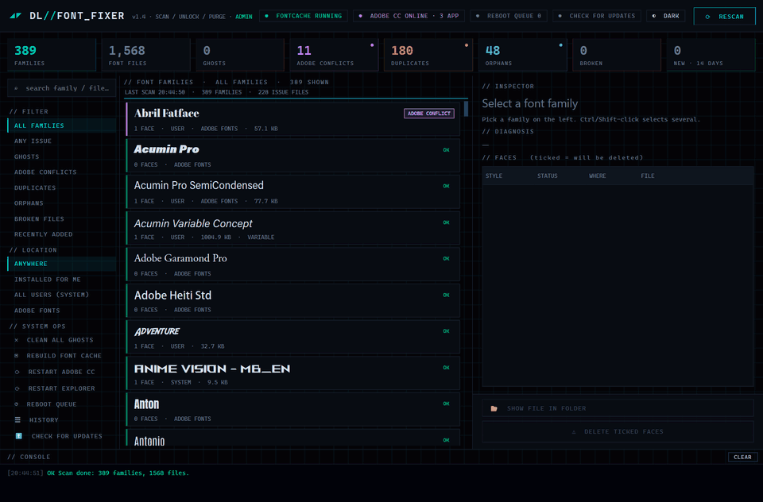
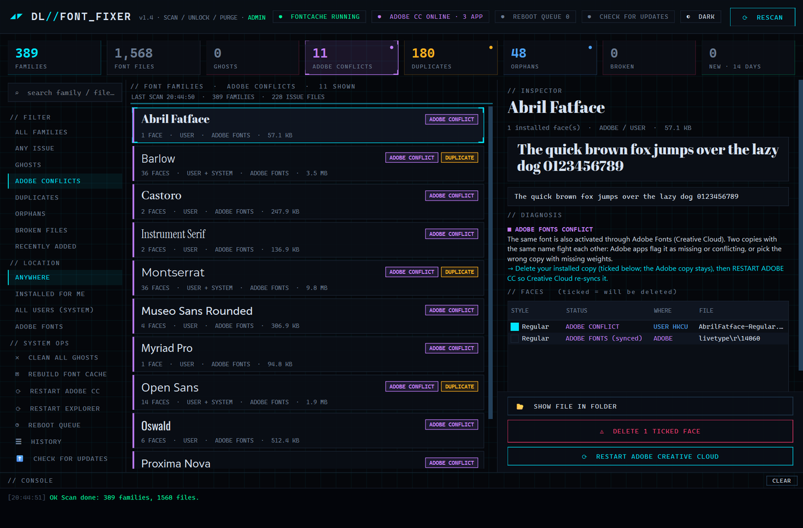
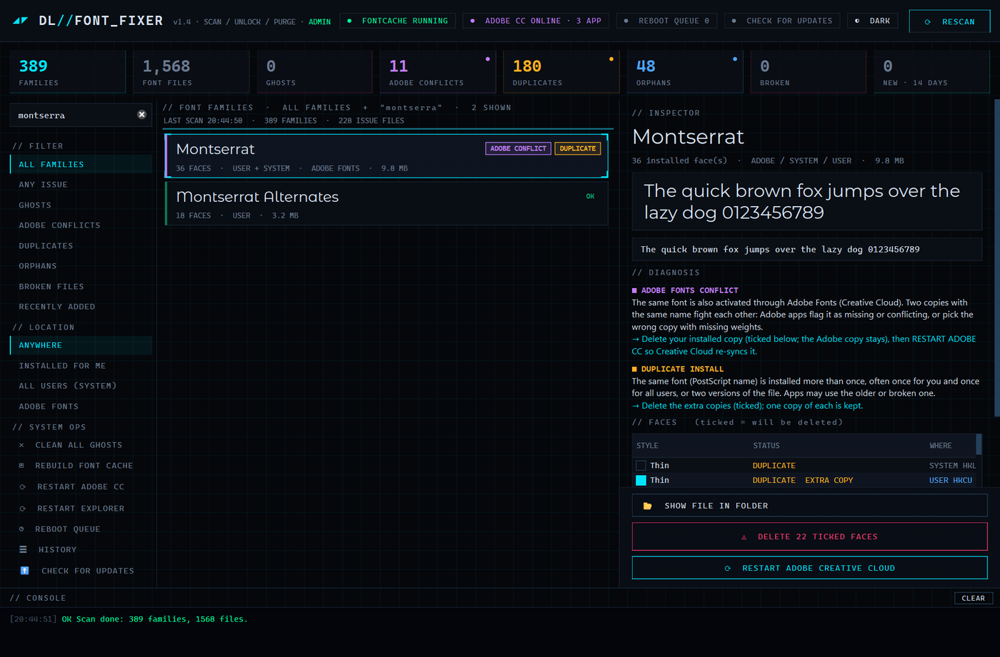
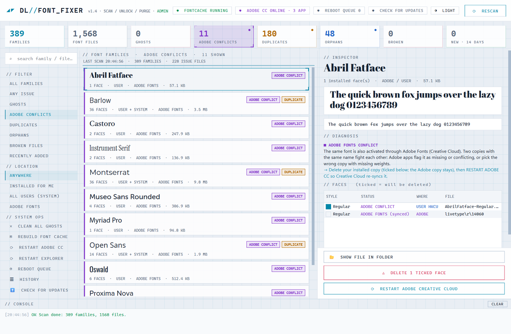
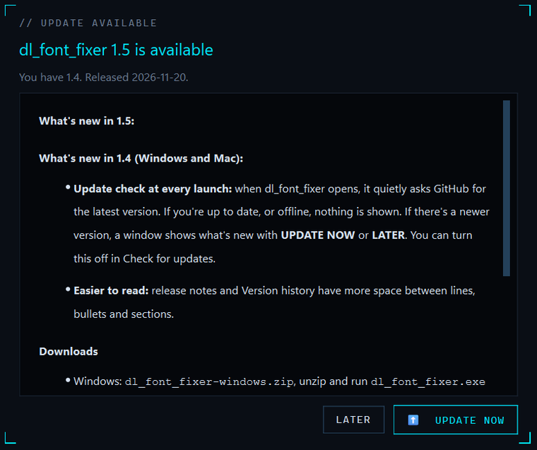
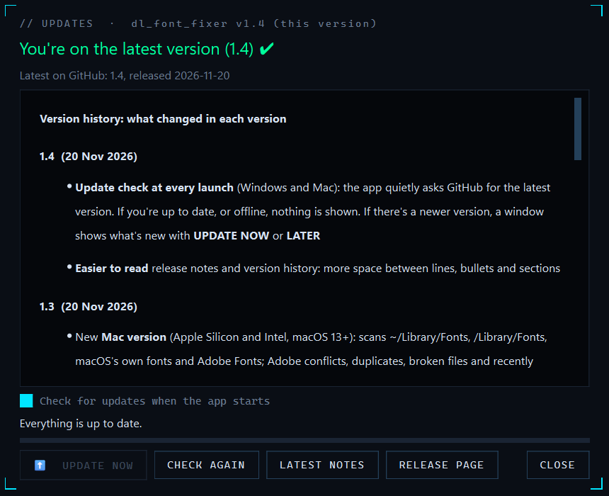

# dl_font_fixer

A Windows and Mac tool for fonts that won't go away. It finds **ghost registry entries**, **orphan files**, **duplicate
installs** and **Adobe Fonts conflicts**, tells you which program is **locking** a font file, and **purges** fonts
completely (registry + file), even when Windows says the file is in use. No CMD, no Safe Mode.



**Download:** see [Releases](../../releases).

- **Windows:** `dl_font_fixer-windows.zip`, unzip it and run `dl_font_fixer.exe`.
- **Mac:** `dl_font_fixer-mac-apple-silicon.dmg` (M1 and later) or `dl_font_fixer-mac-intel.dmg`. Drag the app to
  Applications. The first time, macOS blocks it because it isn't notarized: System Settings › Privacy & Security ›
  **Open Anyway**.

## Screenshots

**An Adobe Fonts conflict:** a font installed by hand that's also activated in Creative Cloud. The inspector explains
the problem, ticks your installed copy for deletion and leaves the Adobe copy alone.



**Duplicates:** the same family installed for you and for all users. One copy of each face is kept, the extras are ticked.



**Light mode** (THEME in the top bar: Dark, Light or Match Windows / macOS).



<table>
<tr>
<td width="50%"><b>Update check at launch</b>: shown only when a newer version exists.<br><br></td>
<td width="50%"><b>Version history</b>: what changed in every version.<br><br></td>
</tr>
</table>

## On a Mac

Macs have no font registry, so there are no ghost entries or orphans: a font is installed when its file is in
`~/Library/Fonts` (you) or `/Library/Fonts` (all users). dl_font_fixer scans both, plus macOS's own fonts in
`/System/Library/Fonts` (never touched) and Adobe Fonts, and shows Adobe conflicts, duplicates, broken files and
recently added fonts. Deleting moves the file to the **Trash** (History can put it back until you empty it); fonts
in `/Library/Fonts` ask for your password. Rebuild font cache clears your Mac's font caches (`atsutil`).

## The problem it solves

You installed a font by hand, and later Adobe Fonts (Creative Cloud) activated the same font. Now Photoshop or
Illustrator shows missing weights or a red-dot conflict. Windows › Fonts refuses to remove the old copy because
the file is "in use". dl_font_fixer shows the conflict, removes the local copy and its registry entry, unlocks or
queues the file if needed, and restarts Creative Cloud so Adobe Fonts re-syncs.

## What it scans

- Registry: `HKLM` and `HKCU` `…\Windows NT\CurrentVersion\Fonts`
- Files: `C:\Windows\Fonts` (all users) and `%LOCALAPPDATA%\Microsoft\Windows\Fonts` (just you)
- Adobe Fonts activated by Creative Cloud: `%APPDATA%\Adobe\CoreSync\plugins\livetype` (read only, never touched)

Fonts are grouped by family (every weight, italic and variable file under one card). Each family shows:

| Badge | Meaning |
|---|---|
| **GHOST** | A registry entry points to a file that no longer exists |
| **ADOBE CONFLICT** | The exact same font (PostScript name) is also activated through Adobe Fonts |
| **DUPLICATE** | The same font is installed more than once (for you *and* for all users, or two files) |
| **ORPHAN** | A font file sits in a Fonts folder but nothing registers it |
| **BROKEN** | The file isn't a readable font |
| **NEW** | Installed in the last 14 days (filter: *Recently added*) |

*Recently added* uses the date you installed the font. dl_font_fixer remembers which fonts it has seen, so
Windows Update rewriting its own fonts or Creative Cloud re-syncing Adobe Fonts doesn't count as new.

The inspector explains each problem in plain words and ticks the faces that should go (for duplicates one
copy is kept). **Right-click a family** (or press **Delete**) to remove the whole font from Windows; a warning
lists exactly what will be deleted first.

**Adobe Fonts** are managed by Creative Cloud, not by Windows, so dl_font_fixer never deletes them (Creative
Cloud would put them back anyway). For an Adobe-only font the delete and folder buttons are greyed out: deactivate
it in Creative Cloud › Fonts instead. When the same font is installed by hand *and* in Adobe Fonts, deleting removes
only your installed copy. Core Windows fonts like Segoe UI or Arial are protected too.

## Purge: what happens

1. The font is unloaded from the session (`RemoveFontResource`) and its `HKCU`/`HKLM` registry values are deleted.
2. The file goes to the **Recycle Bin**. If it's locked, the **Restart Manager** finds who holds it, the app stops the Font Cache
   service and restarts Explorer if needed, then tries again (programs holding it are listed in the console).
3. Still locked? It's renamed to `.old` and, as administrator, queued for deletion at the next restart
   (`PendingFileRenameOperations`). Windows no longer loads it either way.

## System ops

- **Clean all ghosts**: remove every registry entry whose file is missing.
- **Rebuild font cache** (admin): stops `FontCache`, deletes `FNTCACHE.DAT` and the cache files, starts it again.
- **Restart Adobe CC**: closes Creative Cloud, CoreSync and CCXProcess and starts Creative Cloud again.
- **Restart Explorer**: Explorer keeps font files open for previews.
- **Reboot queue**: font files waiting to be deleted at the next restart.
- **History**: every font deleted with dl_font_fixer: name, file, registry entry and when, marked
  *in Recycle Bin (recoverable)* or *deleted (can't recover)* once the Recycle Bin is emptied. **Restore** puts a
  recoverable font back where it was, registry entry included.
- **Check for updates**: asks GitHub for the latest version and installs it in place. Every time the app opens it
  checks quietly: nothing is shown when you're up to date or offline; when a newer version exists, a window offers
  **UPDATE NOW** or **LATER**. **Version history** shows what changed in every version.
- **Theme**: Dark, Light or Match Windows (THEME in the top bar), switches straight away.

The app asks Windows for administrator rights when it starts (fonts for all users, the font cache and the reboot
queue need them); click **Yes**. If you click No it still opens, limited to fonts installed for your user.
Creative Cloud and Explorer are always restarted with your normal rights, never as administrator.

## Build from source

Windows:

```
py -3.13 -m venv .venv
.venv\Scripts\pip install -r requirements.txt
.venv\Scripts\python run.py          # run
.venv\Scripts\python build.py        # -> dist\Windows\dl_font_fixer-windows.zip
```

Mac (GitHub Actions builds both Mac versions on every push, see `.github/workflows/mac.yml`):

```
python3 -m venv .venv && .venv/bin/pip install -r requirements.txt
.venv/bin/python tests/test_mac.py   # throwaway-font test: scan, Trash, History, restore
.venv/bin/python build_mac.py        # -> dist/MacOS/dl_font_fixer-mac-<arch>.dmg
```

`dl_font_fixer.exe --scan-report FILE` writes a JSON report of everything found without changing anything;
`--check-update FILE` writes what GitHub reports as the latest version.

PySide6 (LGPL), fontTools (MIT) and psutil (BSD) are used under their licenses.
